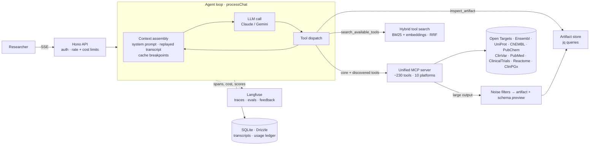

# BURP — Bio Unified Research Platform

**A research agent that answers biomedical questions by working across 10 public databases: it resolves identifiers, chains the right tools, and cites the records it found.**

Live at [tryburp.com](https://tryburp.com) · TypeScript · Bun · Hono · Next.js · Vercel AI SDK · MCP · Langfuse

> *"Which kinase inhibitors in clinical trials target proteins linked to HER2-positive breast cancer, and what pharmacogenomic variants affect their dosing?"*
>
> Answering that by hand means Open Targets → Ensembl → UniProt → ChEMBL → ClinicalTrials.gov → PharmGKB, with a different identifier scheme at every step. BURP does that loop for you and links every claim back to a source record.

---

## The product problem

Biomedical researchers already have great databases. What they lack is a way to **join** them. Each source has its own API and its own IDs (ENSG, UniProt accessions, CHEMBL IDs, PubChem CIDs, rsIDs, NCT numbers, PMIDs). Even the big integrators don't fully cover each other (Open Targets breaks on ClinPGx and UniProt lookups, for example). So a cross-database question turns into an afternoon of copying IDs between browser tabs.

A plain chatbot doesn't solve this. It makes up plausible identifiers, and researchers can't use an answer they can't trace. The product constraints I designed against:

1. **Every fact must come from a tool call, not model memory**, and every ID has to be checkable.
2. **ID mapping is the core skill.** If the agent can't get reliably from a gene symbol to the right drug and trial records, nothing downstream works.
3. **It has to stay affordable per question.** Real research questions take 10–20 tool calls and return very large JSON.
4. **Quality must be measurable.** "It seems better" doesn't count as a release criterion.

---

## Agent design (overview)

The agent is a **single tool-using loop** that I wrote by hand on top of the Vercel AI SDK instead of using an agent framework. That gives me control over the four things that decide whether a research agent works in production: **which tools the model sees, what tool output it reads, what gets cached, and what gets measured.**



### 1. ~230 tools don't fit in a prompt, so the catalog has two tiers

Loading every tool schema on every call would fill a large share of the context window before the user has asked anything, and tool-choice accuracy drops as the list grows.

- **Always-loaded core (~10 tools):** the ID-resolution entry points, i.e. gene symbol → ENSG, drug name → CHEMBL, rsID → gene, condition → NCT. They're set per platform in `config.yaml` (`always_loaded_tools`).
- **Deferred tools (the rest):** the model finds them through a `search_available_tools` system tool. That runs **hybrid search**: BM25 over SQLite FTS plus embedding similarity, merged with Reciprocal Rank Fusion. Keyword matches get extra weight on short queries (`"clinvar variant"`), and embeddings get more on descriptive ones.
- **Provider-aware wiring:** on Anthropic the catalog uses native `defer_loading` with `tool_reference` results, so discovered tools become callable without changing the cached prefix. On other providers, matching tools are injected into the active set on the fly.
- The embedding index **syncs itself**: at boot and whenever the MCP tool set changes, only new or changed tools are re-embedded. If no embedding key is set, search falls back to keyword-only.

→ `app/server/orchestration/context/tool-catalog.ts`, `app/server/search/hybrid-search.ts`, `app/server/embeddings/`

### 2. Tool output is the real context problem, so it's handled in layers

A single UniProt or ChEMBL call can return megabytes of JSON. Truncating it loses data, and passing it through as-is overflows the context. Each MCP result goes through a fixed pipeline:

| Size after step | What the model receives |
|---|---|
| Small enough | The raw output, inline |
| Too large → **deterministic noise filters** (jq policies per platform or tool, e.g. strip sequences and evidence arrays, cap result lists) | The reduced JSON, inline |
| Still too large | Stored as a **session-scoped artifact**. The model gets a **schema preview** (shape, sample items, sizes) plus an artifact ID |

The model then pulls exactly what it needs with an `inspect_artifact` tool that runs **jq filters** against the stored data (`[.results[] | select(.phase >= 3) | {id, name}]`), with timeouts and output caps. The model only sees the full data through targeted queries.

→ `app/server/orchestration/large-output.ts`, `app/server/orchestration/tools/{noise-reduction,schema-preview,artifact-store,jq-engine}.ts`

### 3. Context assembly is built for prompt caching and lossless replay

Multi-turn research is expensive if each turn re-sends the whole conversation uncached, so the context layout is deliberate:

- The tool catalog is **sorted and hashed**. If it ever changes between turns, a `catalog_changed` warning is logged, because that silently breaks the cache.
- Cache breakpoints sit on the system prompt, the **previous call's last message**, and the current last message, so each loop iteration reads the prefix the previous one wrote.
- The transcript is stored **as the provider returned it**, including thinking signatures and provider metadata that later calls need, and tagged with a `contextVersion` (a hash of the system prompt + provider options). If the prompt or model changes, old history degrades gracefully instead of corrupting the request.
- A separate **prompt-cache gate** script checks cache hit behaviour and lossless replay against the live API after SDK or model upgrades.

→ `app/server/orchestration/context/`, `app/scripts/prompt-cache-gate/`

### 4. Grounding by construction

- The system prompt requires tools over training knowledge, evidence over recommendations, and links for every PMID and NCT ID.
- Every tool result is stamped `[fetched_at: <UTC>]`, so the model can tell that a trial's recruitment status from three turns ago may be out of date and fetch it again.
- **`id_grounding`** is a measured metric, not a hope: it checks that every database ID in an answer appeared in evidence the model actually had *before* writing it (see [Evals](#evaluation-as-code)).

### 5. A loop that survives production

The loop is an `AsyncGenerator` of typed stream events (`tool_start`, `tool_end`, text, reasoning, usage). It's consumed directly by the SSE route and by the eval runner, so evals exercise exactly the code path users hit.

- **Per-session turn lock**, client-disconnect and server-shutdown **abort propagation** all the way down to in-flight HTTP requests, and a max-iterations guard.
- **Cost as a first-class limit:** every call is metered in pico-USD, including cache read/write pricing tiers. A turn budget is checked before each model call, and users have daily and monthly cost caps. Failed and aborted turns still write an accurate usage ledger.
- **Errors are classified** (refusal, budget, tool timeout, upstream failure) into a user-facing message and a machine-readable code that feeds traces and evals.

→ `app/server/orchestration/chat-v2.ts`, `tool-dispatch.ts`, `cost-budget.ts`, `usage-meter.ts`

### 6. One MCP server, many unreliable upstreams

All 10 platforms live in **one unified MCP server** (a stdio child process) instead of ten. Each platform is a module that exports `{ name, tools, handlers }`, and tools are namespaced as `platform__tool`. Adding a database means adding a module.

Public bioinformatics APIs are flaky in different ways, so every client goes through a **shared HTTP retry layer**: error classification (retryable vs. not, per status/reason), exponential backoff with jitter, a total time budget per tool call, `Retry-After` handling for 429s, and abortable token-bucket rate limiting for the NCBI APIs (PubMed and ClinVar), which allow more requests per second when an API key is set. Retry attempts and upstream timings appear as metadata on each tool span.

→ `mcp-server/src/shared/http-retry*.ts`, `mcp-server/src/platforms/*/`

---

## Evaluation as code

Datasets, metrics and rubrics are **versioned in git** and synced to Langfuse, which stores traces, experiment runs and scores.

```text
trace every turn  →  run datasets as experiments  →  review failing traces  →  grow datasets from real traces
```

- **Datasets:** `smoke` (cheap, runs on every change) and `deep` (multi-turn target-selection cases, runs before releases). Items carry per-turn checkpoints with accepted aliases, expected tool globs and a `reviewed_by` field. Unreviewed, model-drafted expectations run but never count toward pass/fail.
- **Code evaluators** (pure functions, fixture-tested): `id_grounding`, `checkpoint_recall`, `expected_tool_coverage`, `turn_outcome`, `answer_truncated`, `tool_error_count`.
- **Reproducible runs:** each experiment pins the dataset version and hash, git SHA, model, effort and evaluator hashes. It refuses to start if the hosted dataset drifted from git or tool search isn't indexed.
- **Model × effort matrices:** `bun run eval --dataset smoke --matrix sonnet-effort --repeat 2` runs each arm under a shared cost cap and writes a comparison report with variance.
- **User feedback** (thumbs and categorised comments from the UI) is synced onto the same traces as scores, which feeds the error-analysis loop.

→ `app/evals/`, `app/server/observability/`

---

## The rest of the platform

| Area | What's there |
|---|---|
| **Frontend** | Next.js (static export served by the API), streaming chat with collapsible reasoning and grouped tool-call cards, tool browser, PDF export of conversations, feedback dialog, admin panel, waitlist/access requests |
| **API** | Hono + Zod OpenAPI (Swagger UI), Clerk JWT auth, per-user rate and token limits, SSE streaming |
| **Data** | SQLite (WAL) + Drizzle ORM. Migrations run on boot inside one transaction, with an automatic `VACUUM INTO` backup first. Legacy schema adoption, and a CI drift guard that fails if the schema changes without a migration |
| **Testing** | 110+ test files: unit tests for both packages, typechecks, and **nightly contract tests against the live upstream APIs** that upload a drift report when a database changes its response shape |
| **Delivery** | Multi-stage Docker build on Fly.io, deploy on merge with generated release notes, and an agent-driven workflow that tries to fix failing CI on the dev branch |
| **Observability** | Structured JSON logs with session/turn context, plus OpenTelemetry → Langfuse spans per generation, tool and retriever call |

### Integrated databases

| Platform | Domain | Platform | Domain |
|---|---|---|---|
| Open Targets | Target–disease–drug evidence | ClinVar | Clinical variant interpretation |
| Ensembl | Genes, transcripts, variants | PubMed | Literature |
| UniProt | Proteins & annotations | ClinicalTrials.gov | Trial registry |
| ChEMBL | Bioactivity & drug mechanisms | Reactome | Pathways |
| PubChem | Chemical structures & assays | ClinPGx (PharmGKB) | Pharmacogenomics |

---

## Repository layout

```text
app/
├── server/
│   ├── orchestration/     # agent loop, tool dispatch, context assembly, large-output pipeline, cost budget
│   ├── search/            # hybrid BM25 + embedding tool search
│   ├── embeddings/        # provider-agnostic embedder + incremental index sync
│   ├── mcp/               # MCP child-process manager and tool registry
│   ├── llm/               # provider abstraction (Anthropic, Google, OpenAI)
│   ├── observability/     # Langfuse tracing, scores, feedback sync
│   ├── db/                # Drizzle schema, migrations, queries, backup/verify CLIs
│   └── routes/            # chat (SSE), sessions, tools, usage, admin, feedback
├── evals/                 # datasets, metrics, rubrics, evaluators, experiment runner
├── web/                   # Next.js frontend
└── config.yaml            # models, pricing, tool tiers, search weights, artifact policies
mcp-server/
└── src/
    ├── platforms/         # one module per database (client + tools + contract tests)
    └── shared/            # HTTP retry, rate limiter, tool-call context
docs/                      # architecture diagrams, codemaps, use cases, decisions
plans/                     # design docs written before each major change
```

---

## Running locally

Requires [Bun](https://bun.sh) and Node 18+ (Node runs the MCP child process).

```bash
bun install
cp app/.env.example app/.env              # ANTHROPIC_API_KEY, CLERK_SECRET_KEY; optional NCBI_API_KEY, OPENAI_API_KEY
cp app/web/.env.example app/web/.env.local  # Clerk publishable key, API URL

bun run dev        # builds the MCP server, then runs MCP + API (:3000) + web (:3001)
bun run test       # unit tests for mcp-server and app
bun run eval --dataset smoke --max-cost-usd 0.5
```

Models, tool tiers, search weights and output-handling policies are set in `app/config.yaml`. The database is created and migrated on first boot. See `docs/architecture.md` for deployment and operational details.
